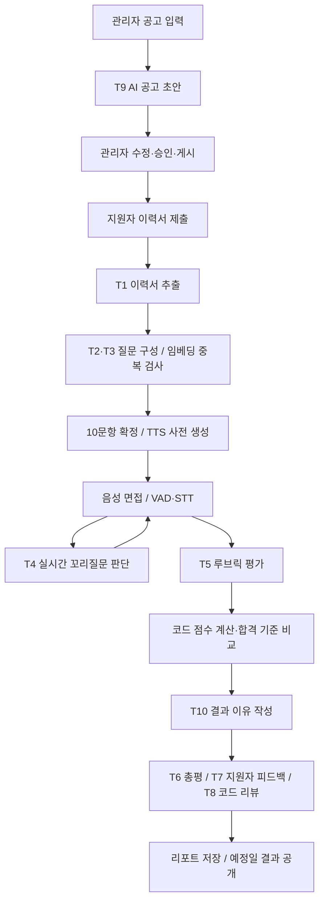

# AI 아키텍처 — LLM 오케스트레이션 구조

> **문서 기준:** 2026-10-30 · AI 아키텍처 v1.4 (`ai-architecture.md`)  
> **관련 기준:** `ai-hiring-platform` 브랜치, PRD v1.6, TRD v1.5, ADR-0003/0005/0006/0008/0013/0014  
> **목적:** AI 기반 1차 채용면접 플랫폼의 AI 처리 구조, 태스크 역할, 자원 운영, 평가·판정 및 장애 대응 방식 안내  
> **범위:** 모델의 구체적인 제품명·버전 확정보다는 역할별 구조 설명. GPU 6GB 설정은 검증 전 **테스트 예시 프로필**입니다.

## 1. 문서 개요

본 문서는 AI 기반 1차 채용면접 자동화 플랫폼의 **LLM 오케스트레이션 아키텍처**를 설명합니다. LLM끼리 직접 호출하거나 대화하지 않으며, **애플리케이션 코드(API·Worker·Scheduler)**가 단일 목적 태스크 **T1~T10**을 호출하고 JSON 출력을 검증하여 다음 처리로 전달합니다.

채용공고 초안 생성부터 이력서 추출, 면접 질문 구성, 음성 기반 면접, 답변 평가, 1차 결과 및 리포트 생성까지 연결합니다. **AI(T5)가 루브릭에 따라 항목별 점수를 평가하고, 코드는 가중치·총점·합격 기준 비교를 수행**합니다. 1차 결과는 `총점 >= 공고별 합격 기준`으로 자동 확정되며, T10은 **결과를 변경하지 않고 근거에 기반한 이유만 작성**합니다. 확정된 1차 결과는 관리자가 변경하지 않으며, 2차 이후 채용 결정은 사람이 담당합니다.

### 1.1. 주요 개정 사항

| 버전 | 주요 변경 내용 |
|---|---|
| v1.1 | AI 공고 초안 T9, 1차 결과 이유 T10, GPU 6GB 테스트 프로필, T5 채점 기준 반영 |
| v1.2 | 질문 생성 재시도 기준과 VRAM 예산 공식 보완 |
| v1.3 | Celery 5.4 + Redis 7 기반 비동기 작업 큐 정리 |
| **v1.4** | **1차 합불은 총점과 기준 점수 비교로만 결정; T10은 결과 설명 전용** |

## 2. 전체 처리 구조

**핵심 원칙:** AI는 생성·평가·설명을 담당하고, 검증·점수 계산·기준 비교·상태 전환은 애플리케이션 코드가 처리합니다.

## 3. AI 구성 요소 및 실행 환경

| 구성 요소 | 역할 | 6GB 테스트 프로필 |
|---|---|---|
| GPU LLM (`llm-gpu`) | RT 꼬리질문, INTERACTIVE 질문·이력서·공고 초안, BATCH 답변 평가·리포트 | 4B급 GGUF Q4_K_M, GPU, 슬롯 `N + compose_slots` |
| 결정 LLM (`llm-eval`) | DECISION 레인, T10 결과 이유 작성 | 8B급 Q4_K_M, CPU 전용 |
| STT (`stt`) | 음성 → 텍스트 | large-v3-turbo급, `int8_float16`, GPU |
| TTS (`tts`) | 질문 텍스트 → 48 kHz PCM | CPU |
| 임베딩 (`embed`) | 생성 질문 중복 검사 | CPU, 코사인 유사도 0.85 이상 중복 |
| API·Worker·Scheduler | 요청 처리, 비동기 실행, 스케줄링 | 애플리케이션 코드 |

런타임은 OpenAI 호환 **llama.cpp** 서버이며, `chat(messages, schema, options)` 인터페이스로 추상화되어 다른 런타임으로 교체할 수 있습니다. `AIHIRE_AI_MODE`는 `direct`(배포), `service`(로컬 개발), `fake`(구성 점검 전용)를 구분합니다.

### 3.1. 처리 레인

| 레인 | 처리 목적 | 기본 데드라인 | 6GB 프로필 실행 위치 |
|---|---|---|---|
| `RT` | 면접 중 꼬리질문 판단 T4 | 5초 | GPU LLM |
| `INTERACTIVE` | 이력서·질문·공고 초안 T1·T2·T3·T9 | 120초 | GPU LLM |
| `BATCH` | 답변 평가·총평·피드백·코드 리뷰 T5~T8 | 600초 | GPU LLM, 동시 1개 |
| `DECISION` | 결과 이유 작성 T10 | 600초 | CPU 결정 LLM |

Gateway는 같은 서버에서 `RT > INTERACTIVE > BATCH` 우선순위를 적용합니다. 상위 레인이 요청하면 하위 작업을 선점할 수 있으며, 선점된 작업은 재개 대상이 되고 시도 횟수를 소모하지 않습니다.

### 3.2. GPU 6GB 테스트 자원 예산

| 항목 | 추정 VRAM |
|---|---:|
| GPU LLM 4B Q4_K_M | 약 2.5GB |
| KV 캐시 `(N + compose_slots) × 약 0.3GB` (예: 2+1) | 약 0.9GB |
| STT | 약 1.0GB |
| 실행환경 | 약 0.5GB |
| **총합** | **약 4.9GB / 관리 상한 5.4GB** |

수치는 추정치이며 브라우저·웹캠과 별도 CUDA 프로세스의 메모리까지 TRD 13-2 성능 시험에서 확인해야 합니다. 더 큰 GPU 환경에서는 모델 크기·동시 슬롯·레인별 서버 배치를 변경하되 태스크 인터페이스와 검증 구조는 유지합니다. **진행 중인 공고의 평가 모델 프로필을 임의로 변경하지 않습니다.**

## 4. 호출 계층 및 검증

`호출자 → AIClient → run_task(TaskSpec) → Gateway → LLM 서버 → JSON 응답 → Pydantic·규칙 검증 → Outcome`

- **AIClient:** 태스크의 레인을 서버에 연결하고 데드라인, 장애 변환, manifest 해시를 관리합니다.
- **run_task:** LLM 호출 전 규칙 검사(preflight), 입력 분할·병합, 형식 재시도, 재생성 및 fallback을 처리합니다.
- **TaskSpec:** 시스템 프롬프트, JSON 출력 스키마, 모델 옵션, 검증 규칙, 재시도 한도를 정의합니다.
- **Gateway:** 우선순위, 선점, 동시 실행 제한, 서버 상태 및 데드라인을 관리합니다.
- **검증:** 원문 인용 위치 검증, 금지 표현 검사, Pydantic 스키마 검사, 개인정보 최소화 및 manifest 버전 기록을 수행합니다.

## 5. AI 태스크 목록 (T1~T10)

| ID | 태스크 | 레인 | 주요 역할 및 실패 대응 |
|---|---|---|---|
| T1 | `resume_extract` | INTERACTIVE | PDF 이력서 정보 추출, 원문 대조; 실패 시 직접 입력 |
| T2 | `question_generate` | INTERACTIVE | 기업·직무 질문 생성, 근거·중복·금지 질문 검사; 슬롯별 최대 3회 생성, 전체 60초 제한, 질문은행·예비 질문 대체 |
| T3 | `resume_question` | INTERACTIVE | 이력서 기반 질문 2개; 근거 부족·생성 실패 시 경험·프로젝트 예비 질문 |
| T4 | `followup_decide` | RT | `ASK/SKIP` 및 근거 판단; 5초 초과·검증 실패 시 SKIP |
| T5 | `evaluate_answer` | BATCH | 질문별 연결된 루브릭 항목에 **0~5점** 및 검증된 근거 부여; 무응답 0점, 근거 부족 시 재생성 후 `INSUFFICIENT` |
| T6 | `report_summary` | BATCH | 담당자용 총평·강점·개선점 생성, 합불 표현 제한 |
| T7 | `candidate_feedback` | BATCH | 지원자용 강점·개선점 작성; 점수·순위·원문 인용 비공개 |
| T8 | `code_review` | BATCH | 공개 정보와 제출 코드 기반 설명형 리뷰; 숨김 테스트 비공개, 점수 영향 없음 |
| **T9** | **`posting_draft`** | **INTERACTIVE** | **관리자 입력을 채용공고 문장으로 가공; 허위 숫자·조건 삭제, 차별 표현 경고, 실패 시 빈 양식 제공** |
| **T10** | **`pass_reason`** | **DECISION** | **코드가 확정한 합불 결과의 이유만 2~3문장으로 작성; 검증 실패 시 재작성 후 `NEEDS_REVIEW`** |

## 6. 서비스 단계별 오케스트레이션

### 6.1. AI 채용공고 작성 (T9)

관리자가 직무, 근무지, 모집 인원, 일정, 코딩테스트 적용 여부·반영 비율 등의 **확정 값**과 회사 소개·업무·기술 요구사항 등의 **문장화 대상**을 입력합니다. `POST /postings/{id}/draft-ai`는 `draft_posting` 비동기 작업을 등록합니다. T9는 문장 초안만 생성하고, 확정 값은 코드가 그대로 반영합니다. 생성 결과는 **임시저장** 상태이며 관리자가 수정·검토한 후 게시합니다. 자동 게시하지 않습니다. 입력에 없는 연봉·복리후생 등은 생성하지 않도록 검증합니다.

### 6.2. 지원 및 질문 구성 (T1~T3)

지원자가 PDF 이력서를 제출하면 T1이 정보를 추출하고 지원자가 확인합니다. **면접 준비 단계**에서 인성 2문항(질문은행), 이력서 2문항(T3), 기업 2문항·직무 4문항(T2)을 조합하여 총 10문항을 확정합니다. 질문은행 우선·부족분 생성 원칙을 적용하고, 임베딩으로 중복을 확인하며, 확정한 질문의 TTS 음성을 사전 생성합니다.

### 6.3. 실시간 면접 (T4)

`질문 음성 재생 → 답변 음성 수집 → VAD → STT → 개인정보 마스킹된 eval_text → T4 꼬리질문 판단 → ASK 또는 SKIP`

꼬리질문은 **본질문당 최대 1개, 전체 최대 4개**입니다. T4가 시간 초과·검증 실패·인프라 장애를 만나면 면접을 중단하지 않고 SKIP하며 사유를 기록합니다. T5 사전 평가는 비동기 BATCH 레인에서 처리하여 면접의 실시간 응답을 우선합니다.

### 6.4. 평가·자동 1차 판정·리포트 (T5~T10)

1. 면접 종료 후 같은 manifest로 수행한 사전 평가가 있으면 재사용하고, 없으면 T5로 평가합니다.
2. 코드는 질문별 평가항목 점수를 환산하고 가중치 및 코딩테스트 반영 비율을 적용하여 **100점 만점 총점**을 계산합니다.
3. **총점 ≥ 공고별 합격 기준이면 1차 합격, 미만이면 1차 불합격**으로 확정합니다.
4. T10은 확정된 결과를 바꾸지 않고 이유와 검증 가능한 근거를 작성합니다. 검증 실패가 지속되면 `NEEDS_REVIEW`로 둡니다.
5. T6 총평, T7 지원자 피드백, T8 코드 리뷰를 생성해 결과와 리포트를 저장합니다.
6. **공고 마감 다음 날 10:00**에 결과를 일괄 공개하고 알림·메일을 발송하는 흐름을 기준으로 합니다.

확정된 1차 결과는 관리자가 수정하지 않습니다. 관리자는 `NEEDS_REVIEW` 상태의 작업을 재실행할 수 있습니다.

## 7. 비동기 작업 큐

**Celery 5.4 + Redis 7**을 브로커로 사용하고, `llm`, `llm_batch`, `llm_decision`, `cpu`, `runner` 리소스 큐와 전용 Worker를 구분합니다.

| 작업 | 큐 | 우선순위 | 최대 시도/정책 |
|---|---|---:|---|
| `compose_questions` | LLM | 10 | 3 |
| `tts_pregen` | CPU | 15 | 3 |
| `extract_resume` | LLM | 20 | 2 |
| `grade_coding` | RUNNER | 20 | 3, 격리 실행·AI 채점 아님 |
| `draft_posting` | LLM | 30 | 2 |
| `pre_evaluate` | LLM_BATCH | 40 | 1 + 재시도 3 |
| `evaluate_application` | LLM_BATCH + LLM_DECISION | 50 | 1 + 재시도 3 |

DB 커밋 이후 작업을 큐에 넣으며, 누락된 작업은 **5분 주기 점검**으로 재등록합니다. `acks_late`와 멱등 키로 중복 실행에 대비합니다. Redis 장애 시 백그라운드 작업은 중단되며 자동 재시작과 점검으로 복구합니다. 평가 실패 시 **1·2·4분 간격 최대 3회 재시도**, 또는 30분 초과 시 `NEEDS_REVIEW`로 전환합니다.

## 8. 품질·보안·재현성

- **출력 검증:** JSON 스키마 강제 → Pydantic → 비즈니스 규칙 검사.
- **근거 검증:** AI가 제시한 인용을 원문 위치와 대조하며, 확인되지 않은 근거는 인정하지 않습니다.
- **프롬프트 인젝션 대응:** 사용자 입력을 nonce 펜스로 구분하고 의심 플래그를 기록합니다.
- **개인정보 최소화:** 평가 입력에서 이름·연락처·나이·성별 언급을 마스킹하며 이력서는 T5·T10에 제공하지 않습니다.
- **채용공고 검증:** T9는 입력에 없는 수치·조건을 제거하고 차별 가능 표현은 경고합니다. 현 설계에서는 경고만으로 게시를 차단하지 않습니다.
- **평가 일관성:** 모델 digest·프롬프트·옵션·루브릭·규칙 버전을 manifest 해시로 저장합니다. 같은 지원 건의 채점 모델을 임의로 바꾸지 않습니다.
- **판정 분리:** LLM은 점수 산술이나 합격 기준 비교를 수행하지 않으며, T10은 결과를 설명할 뿐 변경하지 않습니다.

## 9. 장애 대응 원칙

| 상황 | 처리 |
|---|---|
| 실시간 T4 타임아웃·오류 | SKIP, 면접 계속, 사유 기록 |
| LLM 서버 중단 | 비동기 작업 연기, 다른 모델로 임의 대체하지 않음 |
| 출력 형식·근거 검증 실패 | 허용된 재시도·재생성 후 실패 상태 처리 |
| T9 초안 생성 실패 | 관리자 입력을 채운 양식으로 대체 |
| T10 이유 검증 실패 | 1회 재작성 후 `NEEDS_REVIEW` |
| 평가 재시도 한도 또는 30분 초과 | `NEEDS_REVIEW`, 관리자 재실행 가능 |
| GPU 자원 초과 | 동시 면접 N 제한 또는 KV 캐시 설정 조정 |

## 10. 남은 기술 검토 및 개선 과제

| 항목 | 검토 내용 |
|---|---|
| GPU 자원 측정 | 6GB 테스트 프로필의 실제 VRAM, 브라우저·CUDA 실행환경 사용량 측정 |
| 처리량 검증 | 동시 면접 N, RT 지연, 평가 결과 10분 목표 검증 |
| 질문 구성 트랜잭션 | `compose_questions`의 DB 읽기 → LLM 호출 → 쓰기 분리 |
| STT 환각 | 무음 구간에서 발생하는 허위 전사 대응 및 VAD 필터 조정 |
| T6 문장 검증 | 저득점 항목이 강점에 포함되지 않도록 검증 |
| T10 처리 속도 | CPU 결정 LLM의 응답 시간 측정 및 필요 시 GPU 이전 검토 |
| 공고 차별 표현 | 경고만 표시하는 정책의 최종 팀 결정(PRD JOB-02, TRD T-08) |

## 11. 문서 관리 안내

이 README는 **AI 아키텍처 v1.4의 개요와 구현 방향을 안내하는 문서**입니다. 상세한 처리 조건, 예외 규칙, 테스트 수치와 구현 경로는 원본 `ai-architecture.md` 및 관련 PRD·TRD·ADR를 기준으로 확인합니다. 문서에 기술된 테스트 프로필·성능 목표는 실제 측정 결과가 아니라 검증 대상일 수 있습니다.

> **현재 핵심 설계:** T1~T10 단일 목적 AI 태스크 + 애플리케이션 코드 오케스트레이션 + RT/INTERACTIVE/BATCH/DECISION 레인 + Celery/Redis 비동기 처리 + 루브릭 AI 채점 및 코드 기반 자동 1차 합불 판정.
