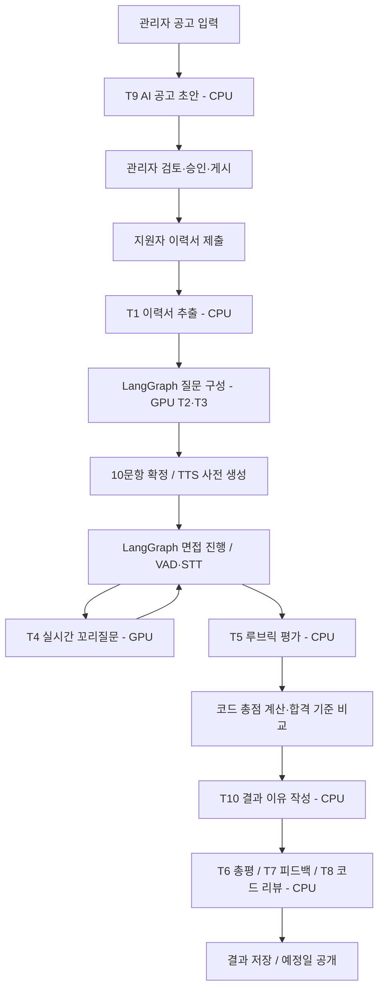

# AI 아키텍처 — LLM 오케스트레이션 구조

> **문서 기준:** 2026-10-30 · AI 아키텍처 **v1.5** (`ai-architecture_v1.5.md`)  
> **관련 기준:** `ai-hiring-platform` 브랜치, PRD v1.6, TRD v1.5, ADR-0003/0005/0006/0008/0013/0014  
> **목적:** AI 기반 1차 채용면접 플랫폼의 모델 역할, LangGraph 오케스트레이션, 비동기 작업, 평가·판정 및 장애 대응 방식 안내  
> **주의:** v1.5의 모델 배치와 LangGraph·LangChain 전환은 **구현 대상**이며, 원본 문서상 현재 코드는 전환 전입니다. GPU 6GB 구성과 수치는 검증 전 테스트 프로필입니다.

## 1. 문서 개요

이 문서는 AI 기반 1차 채용면접 자동화 플랫폼의 **LLM 오케스트레이션 아키텍처 v1.5**를 요약합니다.

LLM끼리 직접 호출하거나 대화하지 않습니다. **애플리케이션 코드(API·Worker·Scheduler 및 LangGraph 그래프)**가 단일 목적 AI 태스크 **T1~T10**을 실행하고, 구조화된 JSON 응답을 검증하여 다음 단계로 전달합니다.

AI는 질문·문장 생성 및 루브릭 채점을 수행합니다. 점수 합산, 가중치 적용, 총점 계산, 공고별 합격 기준 비교는 코드가 담당합니다. **총점 ≥ 합격 기준이면 1차 합격, 미만이면 1차 불합격**으로 확정되며, T10은 결과를 변경하지 않고 이유만 작성합니다. 확정된 1차 결과는 관리자가 변경하지 않고, 2차 이후 채용 결정은 사람이 담당합니다.

### 1.1. 버전별 주요 변경

| 버전 | 주요 변경 내용 |
|---|---|
| v1.1 | AI 공고 초안 T9, 결과 이유 T10, GPU 6GB 테스트 프로필, T5 채점 기준 반영 |
| v1.2 | 질문 생성 재시도·시간 제한 및 VRAM 예산 보완 |
| v1.3 | Celery 5.4 + Redis 7 비동기 작업 큐 정리 |
| v1.4 | 1차 합불을 총점과 합격 기준 비교로만 확정, T10은 결과 설명 전용 |
| **v1.5** | **GPU LLM은 면접 중 T2·T3·T4 중심, CPU 채점 LLM은 T1·T5~T10 담당. 질문 구성·면접 진행에 LangGraph 및 PostgreSQL 체크포인트 적용, 모든 LLM 호출에 LangChain `ChatOpenAI` + `with_structured_output` 사용 예정** |

## 2. 전체 처리 구조

**핵심 원칙:** 그래프의 분기는 코드가 결정하며, LLM은 다음 단계를 자율 선택하지 않습니다. T5가 평가 점수를 생성하고, 코드는 합불을 결정하며, T10은 그 결과를 설명합니다.

## 3. AI 구성 요소 및 실행 환경

| 구성 요소 | 담당 기능 | GPU 6GB 테스트 프로필 |
|---|---|---|
| GPU LLM (`llm-gpu`) | T2·T3 질문 구성, T4 실시간 꼬리질문 판단 | 4B급 GGUF Q4_K_M, GPU |
| 채점 LLM (`llm-eval`) | T1 이력서 추출, T5~T8 평가·리포트, T9 공고 초안, T10 결과 이유 | 8B급 GGUF Q4_K_M, **CPU 전용(`-ngl 0`)**, 동시 1개 |
| STT (`stt`) | 음성 → 텍스트 | large-v3-turbo급, `int8_float16`, GPU |
| TTS (`tts`) | 질문 텍스트 → 음성 | CPU, 48 kHz PCM |
| 임베딩 (`embed`) | 질문 중복 검사 | CPU, 코사인 유사도 0.85 이상 중복 |
| API·Worker·Scheduler | 호출, 비동기 실행, 스케줄링 | 애플리케이션 코드 |

LLM 런타임은 OpenAI 호환 **llama.cpp** 서버를 사용합니다. LLM 호출은 LangChain `ChatOpenAI`와 `with_structured_output`을 통해 구조화합니다. `AIHIRE_AI_MODE`는 `direct`(배포), `service`(로컬 개발), `fake`(구성 점검 전용)를 구분합니다.

### 3.1. 처리 레인

| 레인 | 주요 목적 | 기본 데드라인 | 실행 위치 |
|---|---|---|---|
| `RT` | T4 실시간 꼬리질문 판단 | 5초 | GPU LLM |
| `INTERACTIVE` | T2·T3 면접 질문 구성 | 120초 | GPU LLM |
| `BATCH` | T1 이력서 추출, T5~T9 평가·리포트·공고 초안 | 600초 | CPU 채점 LLM |
| `DECISION` | T10 확정 결과 이유 작성 | 600초 | CPU 채점 LLM |

레인별 우선순위·선점·동시 실행은 Gateway가 관리합니다. 서로 다른 서버로 분리된 작업은 같은 GPU에서 경쟁하지 않도록 설계합니다.

### 3.2. GPU 6GB 테스트 자원 예산

| 항목 | 추정 VRAM |
|---|---:|
| GPU LLM 4B Q4_K_M | 약 2.5GB |
| KV 캐시 `(N + compose_slots) × 약 0.3GB` (초기 2+1) | 약 0.9GB |
| STT | 약 1.0GB |
| 실행 환경 | 약 0.5GB |
| **합계** | **약 4.9GB / 관리 상한 5.4GB** |

이는 측정값이 아니라 설계 추정치입니다. **8B 채점 LLM은 GPU에 일부 올리는 방식이 아니라 CPU 전용**으로 설정한 것이 v1.5의 핵심 변경입니다. GPU 메모리 사용량, STT 동시 실행, 면접 동시 접속 수와 지연은 성능 시험으로 확인해야 합니다.

## 4. 호출 계층과 LangGraph

기본 LLM 호출 경로:

`호출자 → AIClient → run_task(TaskSpec) → Gateway → LangChain ChatOpenAI → with_structured_output → JSON/Pydantic·규칙 검증 → Outcome`

- **AIClient:** 레인·서버 매핑, 데드라인, 장애 변환, manifest 해시 관리
- **run_task:** 사전 규칙 검사, 입력 분할·병합, 형식 재시도·재생성·fallback
- **TaskSpec:** 프롬프트, 출력 스키마, 옵션, 검증 규칙 및 재시도 한도
- **Gateway:** 요청 우선순위, 선점, 동시 실행 제한, 서버 상태 관리
- **LangGraph:** 질문 만들기 및 면접 진행의 단계와 상태를 코드로 제어
- **PostgreSQL 체크포인트:** 그래프 진행 상태 저장 및 중단 후 재개 지원

### 4.1. LangGraph 적용 범위

| 그래프 | 실행 위치 | 주요 노드 및 분기 | 상태 저장 |
|---|---|---|---|
| 질문 만들기 | Worker의 `compose_questions` | 질문 선택 → T2·T3 생성 → 검증 → 재시도 또는 질문은행·예비 질문 대체 | PostgreSQL 체크포인트 |
| 면접 진행 | API, 지원 건별 그래프 | 질문 제시 → 답변 대기(`interrupt`) → STT → T4 판단 → 다음 질문·코딩테스트·종료 | PostgreSQL 체크포인트 |

**지원 건의 실제 응시 상태는 `applications` 테이블이 기준**이고, 체크포인트는 그래프 재개를 위한 상태로 사용합니다.

## 5. AI 태스크 목록 (T1~T10)

| ID | 태스크 | 레인 | 역할 및 실패 대응 |
|---|---|---|---|
| T1 | `resume_extract` | BATCH | PDF 이력서 추출·원문 검증, 실패 시 직접 입력 |
| T2 | `question_generate` | INTERACTIVE | 기업·직무 질문 생성, 근거·중복·금지 질문 검사, 질문은행·예비 질문 대체 |
| T3 | `resume_question` | INTERACTIVE | 이력서 기반 질문 2개, 근거 부족 시 예비 질문 |
| T4 | `followup_decide` | RT | `ASK/SKIP` 판단, 5초 초과·검증 실패 시 SKIP |
| T5 | `evaluate_answer` | BATCH | 루브릭별 0~5점 및 근거 평가, 근거 부족 시 `INSUFFICIENT` |
| T6 | `report_summary` | BATCH | 담당자용 총평·강점·개선점, 합불 표현 제한 |
| T7 | `candidate_feedback` | BATCH | 지원자용 피드백, 점수·순위·원문 인용 제한 |
| T8 | `code_review` | BATCH | 제출 코드에 대한 설명형 리뷰, 채점 결과에 영향 없음 |
| T9 | `posting_draft` | BATCH | 관리자 입력 기반 공고 문장 초안, 허위 조건 제거·차별 표현 경고 |
| T10 | `pass_reason` | DECISION | 코드가 확정한 합불 이유 작성, 실패 시 `NEEDS_REVIEW` |

**v1.4 대비 변경:** T1과 T9는 `INTERACTIVE`가 아니라 `BATCH`로 이동했고, T1·T5~T10은 CPU 채점 LLM을 사용합니다.

## 6. 서비스 단계별 오케스트레이션

### 6.1. AI 채용공고 작성 (T9)

관리자가 직무·근무지·모집 인원·일정·코딩테스트 설정 등 확정 값과 회사·업무·기술 요구사항을 입력합니다. `POST /postings/{id}/draft-ai`는 `draft_posting` 작업을 등록합니다.

T9는 문장 초안을 생성하며, 확정 값은 코드가 유지합니다. 결과는 임시저장 후 관리자 검토·수정을 거쳐 게시합니다. 입력에 없는 연봉·복리후생·수치는 생성하지 않습니다.

### 6.2. 지원 및 질문 구성 (T1~T3)

이력서 제출 후 T1이 CPU 채점 LLM에서 추출을 수행하고 지원자가 확인합니다.

면접 준비 단계에서 **인성 2문항(질문은행), 이력서 2문항(T3), 기업 2문항·직무 4문항(T2)**으로 총 10문항을 확정합니다. LangGraph가 생성·검증·재시도·대체 경로를 제어하며, 임베딩으로 중복을 확인하고 TTS를 사전 생성합니다.

### 6.3. 실시간 면접 (T4)

`질문 음성 재생 → 답변 수집 → VAD → STT → 개인정보 마스킹 → T4 판단 → ASK/SKIP`

꼬리질문은 본질문당 최대 1개, 전체 최대 4개입니다. T4는 5초 초과·오류 시 SKIP하고 면접을 계속합니다. T5 사전 평가는 CPU BATCH에서 비동기 처리하여 GPU 실시간 경로와 분리합니다.

### 6.4. 평가·자동 1차 판정·리포트 (T5~T10)

1. 동일 manifest의 사전 평가가 있으면 재사용하고, 없으면 T5로 평가합니다.
2. 코드는 항목 점수, 가중치, 코딩테스트 반영 비율을 적용하여 **100점 만점 총점**을 계산합니다.
3. **총점 ≥ 공고별 합격 기준**이면 1차 합격, 미만이면 불합격으로 확정합니다.
4. T10은 확정된 결과를 바꾸지 않고 검증 가능한 이유만 작성합니다.
5. T6 총평, T7 지원자 피드백, T8 코드 리뷰를 생성·저장합니다.
6. **공고 마감 다음 날 10:00**에 결과 일괄 공개 및 알림·메일 발송을 기준으로 합니다.

확정된 1차 결과는 관리자가 변경하지 않습니다. `NEEDS_REVIEW` 작업은 관리자가 재실행할 수 있습니다.

## 7. 비동기 작업 큐

**Celery 5.4 + Redis 7**을 사용하며, 리소스 큐 `llm`, `llm_batch`, `llm_decision`, `cpu`, `runner`를 구분합니다.

| 작업 | 큐 | 우선순위 | 시도 정책 |
|---|---|---:|---|
| `compose_questions` | `llm` | 10 | 최대 3회 |
| `tts_pregen` | `cpu` | 15 | 최대 3회 |
| `extract_resume` | `llm_batch` | 20 | 최대 2회 |
| `grade_coding` | `runner` | 20 | 최대 3회, 격리 실행·AI 채점 아님 |
| `draft_posting` | `llm_batch` | 30 | 최대 2회 |
| `pre_evaluate` | `llm_batch` | 40 | 1회 + 재시도 3회 |
| `evaluate_application` | `llm_batch` + `llm_decision` | 50 | 1회 + 재시도 3회 |

DB 커밋 후 큐 등록, 5분 주기 누락 작업 재등록, `acks_late`와 멱등 키를 통한 중복 실행 대비를 적용합니다. 평가 실패는 1·2·4분 간격 재시도 또는 30분 초과 시 `NEEDS_REVIEW`로 전환합니다.

**주의:** 큐 이름은 v1.5 원본 기준을 유지합니다. 별도의 `evaluation`, `document`, `media` 큐로 임의 변경하지 않습니다.

## 8. 품질·보안·재현성

- **구조화 출력:** LangChain `with_structured_output`, JSON 스키마, Pydantic 및 비즈니스 규칙 검증
- **근거 검증:** LLM 인용을 원문 위치와 대조하고 불일치 시 거부
- **사전 규칙:** 무응답·짧은 답·꼬리질문 한도는 불필요한 LLM 호출 생략
- **개인정보 최소화:** 평가 입력에서 이름·연락처·나이·성별 언급 마스킹, T5·T10에는 이력서 미제공
- **채용공고 검증:** 입력에 없는 조건 제거, 차별 가능 표현 경고(현재 설계상 경고만으로 게시 차단하지 않음)
- **평가 재현성:** 모델 digest·프롬프트·옵션·루브릭·규칙 버전을 manifest 해시로 기록
- **판정 분리:** T5는 항목별 점수 평가, 코드는 합불 결정, T10은 이유 설명만 담당
- **정보 보호:** T7에 점수·원문 인용 미제공, T8에 숨김 테스트 미제공

## 9. 장애 대응

| 상황 | 처리 |
|---|---|
| T4 실시간 타임아웃·오류 | SKIP, 면접 계속, 사유 기록 |
| LLM 서버 중단 | 비동기 작업 연기, 다른 모델로 임의 대체 금지 |
| 출력 형식·근거 검증 실패 | 허용된 재시도 후 실패 상태 처리 |
| T9 공고 초안 실패 | 관리자 입력을 채운 기본 양식 제공 |
| T10 이유 검증 실패 | 1회 재작성 후 `NEEDS_REVIEW` |
| 평가 재시도 한도 또는 30분 초과 | `NEEDS_REVIEW`, 관리자 재실행 가능 |
| GPU 자원 초과 | 동시 면접 수 N 제한 또는 KV 캐시 조정 |

## 10. 남은 기술 검토 및 구현 과제

| 항목 | 검토 내용 |
|---|---|
| **v1.5 구현 전환** | CPU/GPU 모델 배치 및 LangChain·LangGraph 실제 코드 반영 |
| GPU 자원 측정 | 6GB 테스트 프로필의 VRAM·STT·CUDA 사용량 검증 |
| CPU 채점 처리량 | 8B CPU 모델의 T1·T5~T10 응답 시간 및 대기열 병목 측정 |
| 실시간 면접 지연 | T4 5초 목표, 동시 면접 N, STT 처리 시간 측정 |
| 평가 처리 목표 | 면접 종료 후 평가·리포트 10분 목표 검증 |
| 질문 구성 트랜잭션 | DB 읽기 → LLM 호출 → DB 쓰기 분리 |
| LangGraph 상태 복원 | PostgreSQL 체크포인트와 `applications` 상태 정합성 검증 |
| STT 환각 | 무음 구간의 허위 전사 및 VAD 필터 검증 |
| T6 문장 검증 | 3점 미만 항목이 강점에 포함되지 않도록 검사 |
| 공고 차별 표현 | 경고만 제공하는 정책의 팀 최종 결정 |

## 11. 문서 관리 안내

이 README는 **AI 아키텍처 v1.5의 개요 및 구현 방향을 안내하는 문서**입니다. 상세한 태스크 입력·출력, 검증 조건, 재시도 정책, 구현 경로 및 예외 처리는 원본 `ai-architecture_v1.5.md`와 PRD v1.6·TRD v1.5·관련 ADR을 확인합니다.

v1.5에서 제시한 **CPU/GPU 모델 역할 분리, LangGraph 그래프, LangChain 구조화 출력은 아직 구현 완료로 간주하지 않습니다.** 실제 코드 반영과 성능 검증 후 상태를 갱신해야 합니다.

> **현재 핵심 설계:** T1~T10 단일 목적 태스크 + LangGraph(질문 구성·면접 진행) + LangChain 구조화 출력 + GPU 면접 중 처리 / CPU 채점·공고·이력서 처리 + Celery/Redis 비동기 작업 + 루브릭 AI 채점 및 코드 기반 자동 1차 합불 판정.
