# AI_면접_통합서비스_플로우차트_05v

# AI 면접 통합 서비스 플로우차트

통합 설계 검토 보고서 | 05v (내부 검토본)

## 문서 개요

본 문서는 AI를 활용한 면접을 진행하기 위해 서비스 전체 흐름과 기능별 처리 절차를 정리한 통합 플로우차트 보고서이다.

## 작성 배경 및 문서의 성격

각 팀원은 담당 기능과 관점에 따라 서로 다른 플로우차트를 작성하였다. 일부 흐름과 세부 구현 방식에는 차이가 있으나, 본 문서는 팀 내 논의를 바탕으로 공통 흐름을 정리한 내부 검토 결과물이다. 실제 구현 결과와 차이가 발생할 수 있으며, 핵심 기능의 누락·중복·보완 사항을 검토하여 이후 버전에서 지속적으로 수정할 예정이다.

## 작성 목적

1. 화면 연계 파악: 플로우차트를 통해 전체 화면과 기능이 어떤 조건에서 연결·전환·복귀하는지 명확히 파악한다.
2. 기능 범위 점검: 사전에 정의한 기능을 확인하고, 불필요한 기능의 포함 여부와 필수 기능의 누락 여부를 검토한다.
3. 팀원 간 인식 조율: 공통 플로우차트를 공유하여 결과물의 범위와 동작 방식에 대한 해석 차이를 줄인다.
4. AI 및 개발 환경 조율: AI 활용 지점과 필요한 라이브러리·프로그램·외부 환경을 확인하고, 버전 및 연동 방식을 조율한다.

## 해석 및 변경 관리 원칙

전체 흐름도는 화면 간 이동과 재진입을 나타내며, 기능별 도면은 내부 처리·조건 분기·실패·재시도 경로를 구체화한다. 도면의 처리 순서는 설계 기준이며, 실제 비동기 처리나 구현 상세는 개발 과정에서 조정할 수 있다.

01v 반영 사항: 02번 질문은행·RAG 생성 흐름에서 관리자 수동 질문 작성 경로를 제거했다. 질문 확보는 질문은행 자동 선택 또는 LLM 자동 생성으로 진행하며, 관리자 역할은 검토·승인에 한정한다.

02v 반영 사항:

1. **00번 전체 흐름도** — 로그인 성공 후 도착 화면을 역할별로 분리했다. 지원자는 공고 목록으로, 관리자는 관리자 대시보드로 진입하며, 마이페이지는 별도 메뉴에서 접근한다. (기존에는 역할 구분 없이 “마이페이지”로 통합 진입하도록 되어 있었음)
2. **01번 회원·공고·지원 흐름도** — 공고 목록 → 공고 상세 → 지원하기로 이어지는 지원자 화면 전환 단계가 누락되어 있어 추가했고, 관리자의 공고 작성/수정 경로와 지원자의 지원 경로를 분리해 혼동을 없앴다.
3. **10번 지원자 마이페이지 흐름도** — “마이페이지·공고 목록”으로 합쳐져 있던 진입 화면을 “마이페이지” 단일 화면으로 정리하고, 공고 목록은 00/01번 흐름도의 화면을 그대로 참조하도록 분리했다.
4. 이미지(PNG) 대신 Mermaid 코드로 전환해 깃/문서 도구에서 직접 편집·리뷰할 수 있도록 했다.

03v 반영 사항:

1. **02번 질문은행·LLM 생성** — 기업 공개문서 검색(Retriever·pgvector, RAG) 단계를 제거했다. 질문은행에 적합한 질문이 부족하면 외부 문서 검색 없이 바로 LLM이 생성한다. 도면명도 “질문은행·RAG 생성” → “질문은행·LLM 생성”으로 변경했다.
2. **04번 코딩테스트 응시** — LLM 보조 코드 작성 옵션(작업 방식 선택, LLM 사용 요청, 토큰·정책 허용 여부)을 전부 제거했다. 코딩테스트는 LLM 지원 없이 일반적인 코딩테스트로 진행한다. 도면명도 “코딩테스트 응시·LLM” → “코딩테스트 응시”로 변경했다.
3. **10번 지원자 마이페이지** — 마이페이지에서 면접/코딩 응시 메뉴를 제거했다(응시는 마이페이지가 아닌 공고 상세에서 진행). 결과 공개 승인 여부를 묻던 분기도 제거해 결과·피드백을 바로 조회하도록 단순화했다.
4. **01번 회원·공고·지원** — 공고 지원 버튼(면접 응시) 클릭 시 ① 개인정보 수집·이용 동의 → ② 이력서 PDF 제출·OCR 텍스트 추출 → ③ AI 면접 시작(03번 도면으로 연결)으로 이어지는 단계를 추가했다.

04v 반영 사항:

1. **07번 면접 평가·리포트** — “담당자 승인?” 게이트를 제거했다. 합불은 관리자 개입 없이 AI가 고정 루브릭 가중합 점수와 사전 설정된 합격 기준점(threshold)을 기준으로 자동 확정하며, 판정 근거(세부 점수·루브릭 버전)는 감사 로그로 저장한다.
2. **08번 관리자 대시보드** — 합불 결정 권한이 07번으로 이전됨에 따라 도면명을 “관리자 대시보드·결정” → “관리자 대시보드·모니터링”으로 변경했다. 지원자 메뉴는 AI 판정 결과·근거를 조회하고 이상 사례를 플래그하는 기능으로 한정하며, 관리자가 판정을 직접 변경하지는 않는다.
3. **03번 AI 면접·꼬리질문** — “꼬리질문 필요?” 분기의 판단 기준을 구체화했다. ① 답변 충분성(STAR 요소·정량 지표 누락), ② 구체성 부족(모호한 답변·사례 없음), ③ 공고 요구 역량 커버리지 미달, ④ 이력서/자소서 내용과의 불일치 중 하나 이상에 해당할 때 꼬리질문을 생성한다. 무한 루프 방지를 위해 질문당 최대 2회, 세션 전체 최대 5회로 한도를 둔다.

05v 반영 사항:

1. **02번 질문은행·LLM 생성** — “재시도 한도 초과 → 재시도 대기 → 재시도”로 이어지는 경로와 “반려 → 재생성” 경로에 상위 상한이 없어 무한 루프가 가능했던 문제를 수정했다. 개별 생성 시도 한도(최대 3회)와 별개로 전체 생성 사이클 한도(개별 재시도 초과·리뷰어 반려 포함 최대 5회)를 추가했으며, 전체 한도를 넘으면 더 이상 자동 재시도하지 않고 “질문 확보 실패 · 공고 보류(관리자 수동 개입 필요)” 상태로 종료한다.

검토 상태: 비공개 내부 초안 / 배포 및 최종 확정 전

## 도면 목록

00 전체 서비스·유기적 화면 이동 / 01 회원·공고·지원 / 02 질문은행·LLM 생성 / 03 AI 면접·꼬리질문 / 04 코딩테스트 응시 / 05 코딩 시나리오 검증 / 06 코드 실행·채점 / 07 면접 평가·리포트 / 08 관리자 대시보드·모니터링 / 09 알림·캘린더 / 10 지원자 마이페이지 / 11 장애·예외·감사

범례: 타원(시작/종료) · 마름모(분기/결정) · 파란 박스(허브 화면, 재진입 지점) · 흰 박스(처리/화면 단계)

---

## 00 전체 서비스·유기적 화면 이동

도면 00 | 세로형 · 조건별 양방향 분기 · 복귀 경로 포함 *(02v 수정)*

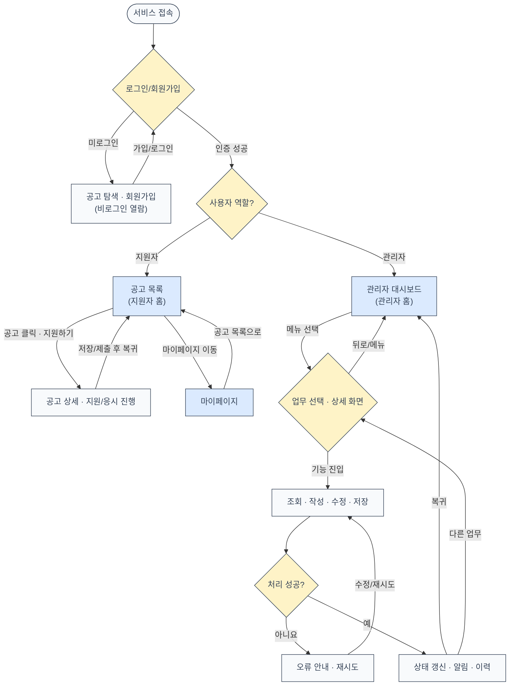

설계 기준: 화면은 일방향 절차가 아닌 허브 기반 탐색 구조다. 저장 후 대시보드로 돌아가거나 다른 업무로 이동할 수 있다. 로그인 성공 시 지원자는 공고 목록, 관리자는 관리자 대시보드로 진입하며, 마이페이지는 별도 메뉴에서 접근한다.

읽는 법: 마름모는 모든 선택지를 명시하며, 되돌아가는 화살표는 재시도·수정·다른 메뉴 이동을 의미한다. 각 상세 흐름도는 대시보드/마이페이지에서 재진입 가능한 기능 단위다.

---

## 01 회원·공고·지원

도면 01 | 세로형 · 조건별 양방향 분기 · 복귀 경로 포함 *(02v·03v 수정)*

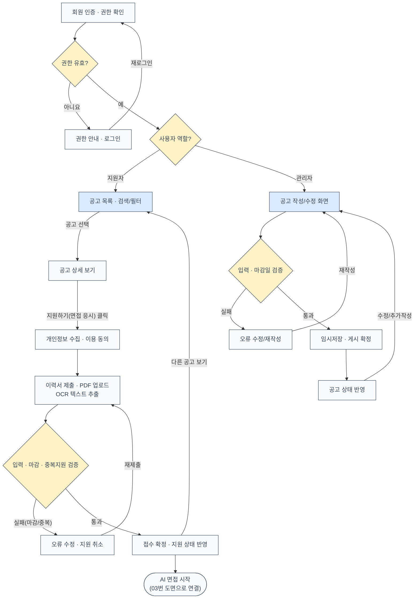

설계 기준: 관리자와 지원자의 권한을 분리하며 마감·중복 지원은 서버에서 재검증한다. 지원자는 공고 목록 → 상세 → 지원하기 순서로 진행하고, 관리자는 별도의 공고 작성/수정 화면에서 작업한다. 지원하기(면접 응시) 클릭 시 개인정보 수집·이용 동의를 먼저 받고, 이력서(PDF)를 업로드해 OCR로 텍스트를 추출한 뒤 AI 면접을 시작한다.

---

## 02 질문은행·LLM 생성

도면 02 | 세로형 · 조건별 양방향 분기 · 복귀 경로 포함 *(03v·04v 수정)*

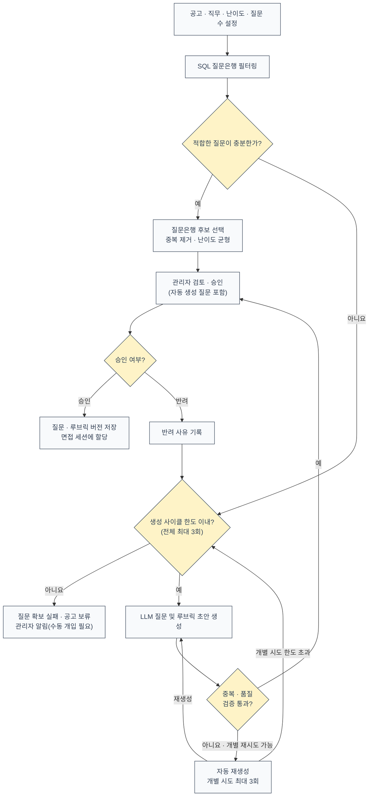

설계 기준: 질문은 관리자 수동 작성 없이 질문은행 자동 선별 또는 LLM 자동 생성으로 확보한다. 외부 기업 문서 검색(RAG) 없이 LLM이 직접 질문·루브릭 초안을 생성한다. 생성된 질문은 중복·품질을 검증하고, 관리자가 승인한 버전만 세션에 할당한다. 무한 루프 방지를 위해 개별 생성 시도(최대 3회)와 전체 생성 사이클(개별 재시도 초과·리뷰어 반려 포함 최대 5회)을 별도로 제한하며, 전체 한도를 넘기면 자동 재시도를 멈추고 공고를 보류 상태로 전환해 관리자의 수동 개입을 요청한다.

---

## 03 AI 면접·꼬리질문

도면 03 | 세로형 · 조건별 양방향 분기 · 복귀 경로 포함 *(04v 수정)*

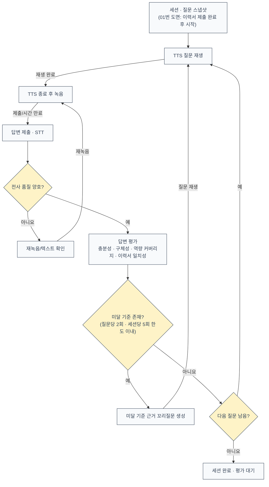

설계 기준: STT 불량은 자동 감점하지 않는다. 타임아웃·장치 장애는 별도 상태로 기록한다. 꼬리질문은 ① 답변 충분성(STAR 요소·정량 지표 누락), ② 구체성 부족(모호한 답변·사례 없음), ③ 공고 요구 역량 커버리지 미달, ④ 이력서/자소서 내용과의 불일치 중 하나 이상에 해당할 때 생성한다. 무한 루프 방지를 위해 질문당 최대 2회, 세션 전체 최대 5회로 제한하며, 한도 도달 시 다음 질문으로 자동 진행한다.

---

## 04 코딩테스트 응시

도면 04 | 세로형 · 조건별 양방향 분기 · 복귀 경로 포함 *(03v 수정)*

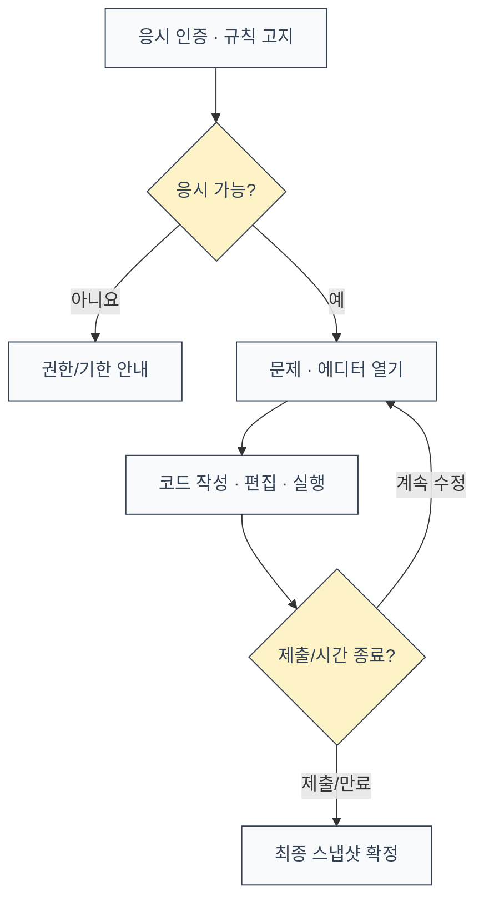

설계 기준: 코딩테스트는 LLM 보조 없이 일반적인 코딩테스트로 진행한다. 작성한 코드와 실행 로그만으로 평가하며, 별도의 AI 사용 이력은 수집하지 않는다.

---

## 05 코딩 시나리오 검증

도면 05 | 세로형 · 조건별 양방향 분기 · 복귀 경로 포함

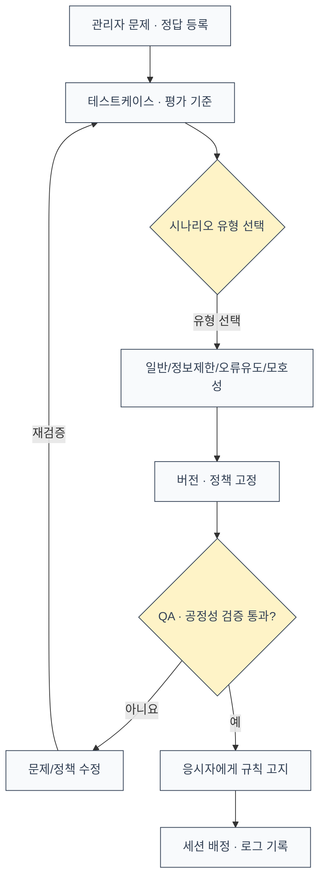

설계 기준: 오류 유도 문항은 검증 가능한 기준과 고지가 있을 때만 사용한다.

---

## 06 코드 실행·채점

도면 06 | 세로형 · 조건별 양방향 분기 · 복귀 경로 포함

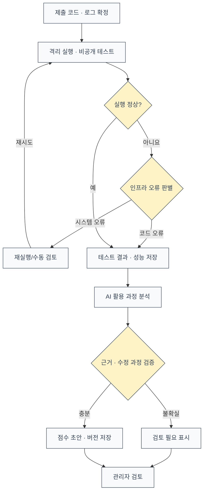

설계 기준: 실행 정확도와 AI 활용 과정 평가를 분리한다. 환경 오류는 응시자 오답으로 취급하지 않는다.

---

## 07 면접 평가·리포트

도면 07 | 세로형 · 조건별 양방향 분기 · 복귀 경로 포함 *(04v 수정)*

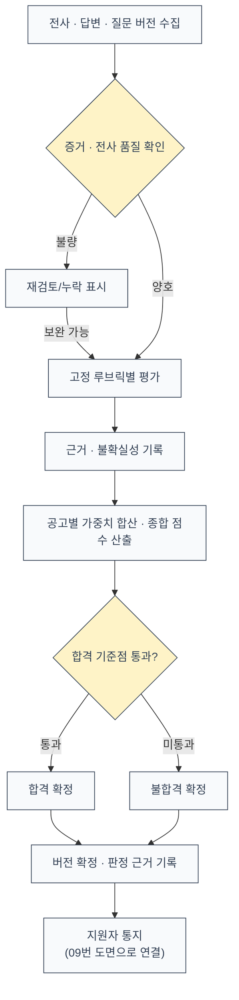

설계 기준: 이력서는 질문 맥락·검토에 활용하며 임의 학력 점수는 부여하지 않는다. 합불 판정은 관리자 개입 없이 AI가 고정 루브릭 가중합 점수와 사전 설정된 합격 기준점(threshold)으로 자동 확정하며, 판정 근거(세부 점수·루브릭 버전)는 감사 로그로 저장해 사후 확인이 가능하도록 한다.

---

## 08 관리자 대시보드·모니터링

도면 08 | 세로형 · 조건별 양방향 분기 · 복귀 경로 포함 *(04v 수정)*

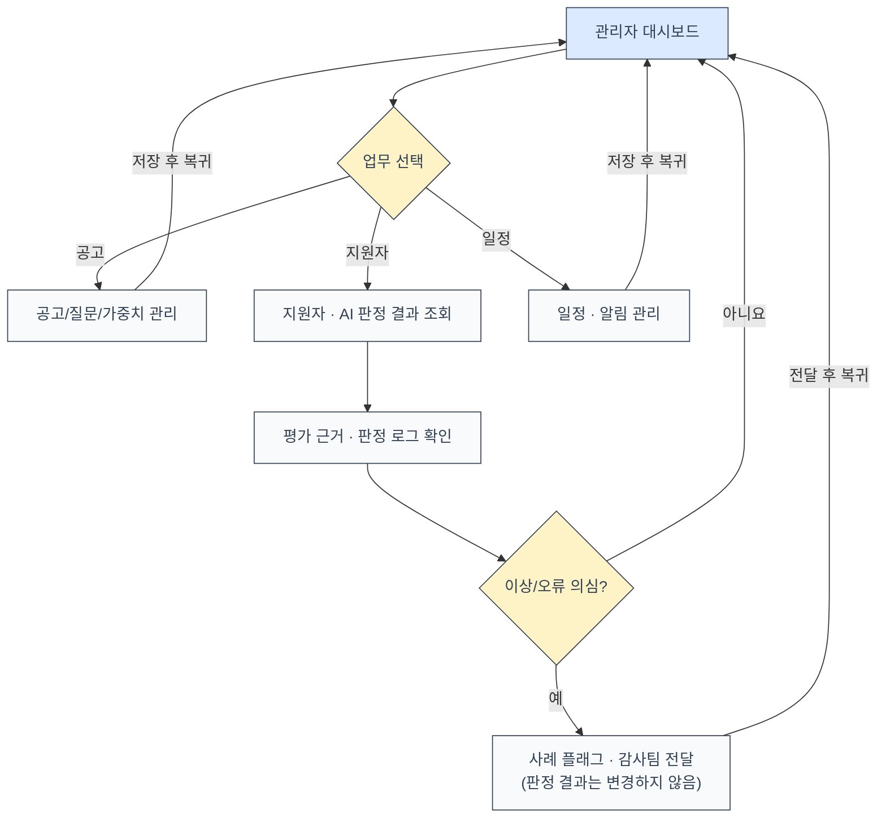

설계 기준: 관리자 화면은 각 메뉴를 자유롭게 오가는 허브다. 합격/불합격은 07번 도면에서 AI가 자동 확정하므로 관리자는 결정권이 없으며, 지원자 메뉴는 AI 판정 결과·근거를 열람하는 모니터링 기능만 제공한다. 이상 사례는 플래그로 감사팀에 전달할 수 있으나 관리자가 직접 판정을 변경하지는 않는다.

---

## 09 알림·캘린더

도면 09 | 세로형 · 조건별 양방향 분기 · 복귀 경로 포함

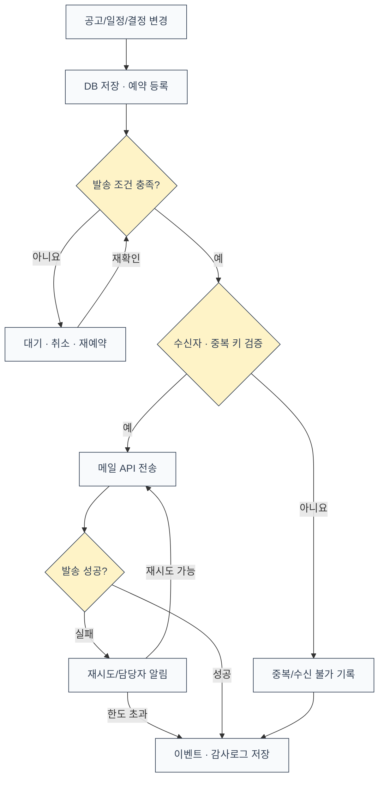

설계 기준: 중복 발송 방지, 상태 재확인, 실패 재시도 한도를 명시한다.

---

## 10 지원자 마이페이지

도면 10 | 세로형 · 조건별 양방향 분기 · 복귀 경로 포함 *(02v·03v 수정)*

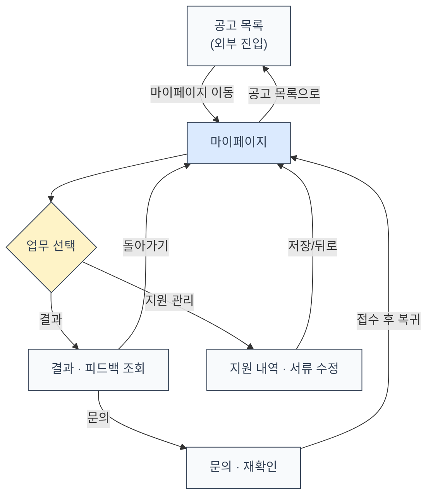

설계 기준: 마이페이지는 지원 내역 조회·수정과 결과·피드백 확인만 제공한다. 면접/코딩 응시는 마이페이지가 아닌 공고 상세(01번 도면)에서 진행하며, 결과 공개 여부를 별도로 승인받는 절차 없이 바로 조회한다. 마이페이지와 공고 목록은 서로 다른 화면이며, 마이페이지는 로그인 후 별도 메뉴에서 진입한다.

---

## 11 장애·예외·감사

도면 11 | 세로형 · 조건별 양방향 분기 · 복귀 경로 포함

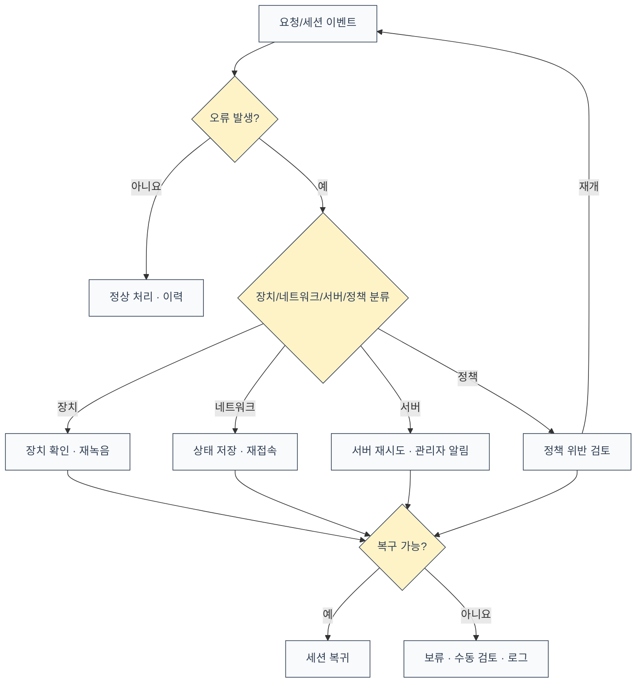

설계 기준: 장애 원인과 지원자 역량 평가는 별도로 저장한다.