# AI 면접 통합 서비스 플로우차트

통합 설계 검토 보고서 | 07v | 기준 문서: 통합 PRD v1.1 (2026-10-28)

## 문서 개요

통합 PRD v1.1의 확정 사항을 기준으로 서비스 전체 흐름과 기능별 처리 절차를 다시 정리한 플로우차트다. 도면의 각 단계에는 PRD 요구사항 ID를 함께 적어 추적할 수 있게 했다. 도면의 처리 순서는 설계 기준이며, 비동기 처리 등 구현 상세는 TRD에서 정한다.

## 07v 반영 사항

PRD v1.1의 팀 피드백 5건 중 흐름에 영향을 주는 4건을 반영했다. 피드백 ③(운영 장비 VRAM 6GB·RAM 58GB)은 흐름 변화가 없어 반영할 곳이 없다. 요구사항 ID 옆 절 번호도 v1.1 목차(1~11장)에 맞췄다.

1. **피드백 ① AI가 1차 합불 판정(07, 00, 09)** — 1차 합격·불합격은 AI가 항목 점수·종합 총점·합격 기준·근거를 바탕으로 판정 사유(2~3문장, 근거 인용 포함)와 함께 낸다. 시스템은 점수를 집계하고 판정이 ‘종합 총점 ≥ 합격 기준이면 합격’과 어긋나지 않는지 검증한다. 어긋나면 AI에 1회 재판정을 요청하고, 그래도 어긋나면 ‘확인 필요’로 넘긴다. 담당자는 판정 결과와 사유를 확인만 한다.
2. **피드백 ② 이메일 인증 후순위(01, 03)** — 인증 없이 가입·지원하는 흐름을 기본으로 바꿨다. 이메일 인증은 추가 후 경로로 점선 표시했다.
3. **피드백 ④ 질문 재생성 상한(04, 11)** — 06v의 ‘세션 전체 3회’ 가정을 PRD QST-05 기준으로 바꿨다. AI 질문 생성·맥락화·범위 조정이 실패하면 **해당 문항을 같은 조건으로 최대 3회** 재생성한다. 3회 모두 실패하면 같은 카테고리의 검증된 DB 질문으로, DB 후보도 없으면 카테고리별 예비 질문 세트로 대체한다. 질문 생성 실패는 장애 판정 대상이 아니다.
4. **피드백 ⑤ 동시 면접 상한 N(03, 10)** — 상한을 ‘GPU 1대당 5건’에서 운영 설정값 N으로 바꾸고, ‘대기’ 상태(6-2 응시 대기)를 추가했다.
5. **이력서 OCR 추가(03, 08-A)** — 팀 결정으로 스캔(이미지) PDF를 온프레미스 OCR로 추출하는 경로를 넣었다. 이력서 파일은 **PDF만** 받으며, 이미지 등 PDF가 아닌 파일은 업로드할 수 없다고 안내한다. OCR이 실패하거나 인식 품질이 기준에 못 미치면 직접 작성으로 넘어가고, 추출 결과는 지원자가 반드시 확인·수정한다. PRD v1.1의 OCR 미지원 문구(N4, APP-04, C-22)는 다음 PRD 개정에서 반영될 예정이다.
6. **용어 통일** — 도면에서 쓰던 용어를 PRD v1.1 용어로 바꿨다. 슬롯 → 문항, 응시 대기 상태 → ‘대기’(6-2), 진행 중 → 면접 진행 중·코딩테스트 진행 중(6-2), 지원 접수 확정 → 지원 완료·‘준비 중’(6-2), 판정 미확정 → ‘판정 전’(6-2), LLM 보조 → AI 도우미(COD-06).

## 06v 반영 사항

05v를 PRD v1에 맞춰 전면 재작성했다.

1. **도면 체계 재구성** — PRD 흐름(가입 → 공고·평가 기준 → 지원·사전 준비 → 질문 구성 → AI 면접 → 코딩테스트 → 평가·판정 → 결과 공개 → 결과 관리)에 맞춰 도면을 00~12로 다시 나눴다. 장애 이어가기와 화면 이탈 처리를 별도 도면으로 분리했다.
2. **질문 구성(04)** — 관리자 검토·승인 단계, 공고 보류 상태, 질문 수·난이도 설정을 제거했다. 시스템이 고정 문항 구성(인성 2·이력서 2·기업 2·직무 4)에 맞춰 자동 구성한다. 생성 사이클은 **세션 전체 최대 3회**로 제한하고, 초과하면 질문 DB 후보로 대체한다.
3. **AI 면접(05)** — 꼬리질문 상한을 질문당 1개·전체 4개로, 판단 기준을 PRD INT-06(논리성·관련성 2점 이하, 이력서 불일치, 일반론, 5초 초과 시 생략)으로 바꿨다. 카운트다운, 답변 시간, 내용 없는 답변 처리를 추가했다.
4. **코딩테스트(06)** — 확정: **LLM 보조 없음, AI 사용 이력 수집 안 함.** 05v 06번 도면의 ‘AI 활용 과정 분석·근거 검증·관리자 검토’를 제거하고, 점수를 테스트케이스 통과율 × 100으로 계산한다. 05v의 04(응시)와 06(실행·채점)을 하나로 합쳤다.
5. **평가·판정(07)** — 합불은 AI가 아닌 **시스템**이 규칙으로 판정한다. 코딩테스트 반영 비중 합산, 0점/1점 규칙, 인용 검증, 분석 오류 재처리를 추가했다. 결과는 즉시 통지하지 않고 마감 다음 날 10:00에 일괄 공개한다(08).
6. **범위 밖 제거** — 일정·캘린더 관리, 이상 사례 감사팀 전달, 관리자 질문 관리, 이력서 OCR, 지원 서류 수정, 관리자 코딩 문제 등록(운영 업무로 이동)을 도면에서 뺐다.
7. **용어** — ‘관리자’를 PRD 용어인 ‘기업 담당자’로 통일했다. 운영 측 업무(계정 발급, 문제 은행, 분석 지연 재처리)는 ‘운영자’로 표기한다.

검토 상태: 내부 검토본 / PRD v1.1 정합 확인용

## 도면 목록

| 번호 | 도면 | 관련 PRD v1.1 | 05v 대응 |
|---|---|---|---|
| 00 | 전체 서비스 흐름 | 2-3, 6-1 | 00 |
| 01 | 회원가입·로그인 | 5-1 | 00, 01 일부 |
| 02 | 공고 작성·평가 기준 설정 | 5-2 | 01 일부, 08 일부 |
| 03 | 지원·사전 준비 | 5-3, INT-08 | 01 일부 |
| 04 | 질문 구성 | 5-5, 7-4 | 02 |
| 05 | AI 면접·꼬리질문 | 5-4 | 03 |
| 06 | 코딩테스트 응시·채점 | 5-6 | 04, 06 (05는 운영 업무로 제외) |
| 07 | 평가·채점·AI 1차 합불 판정 | 5-7, 7-1 | 07 |
| 08 | 결과 공개·알림·보관 삭제 | 5-8, 10-2, ADM-08 | 09 |
| 09 | 기업 담당자 결과 관리 | 5-9 | 08 |
| 10 | 지원자 마이페이지 | 6-2, RES-03, INT-08 | 10 |
| 11 | 장애 이어가기 | 5-10, 7-2 | 11 일부 |
| 12 | 부정행위: 화면 이탈 | 5-11, 7-3 | 11 일부 |

범례: 타원(시작/종료·다른 도면 연결) · 마름모(분기) · 파란 박스(허브 화면, 재진입 지점) · 흰 박스(처리/화면 단계) · 점선(상시 감시)

---

## 00 전체 서비스 흐름

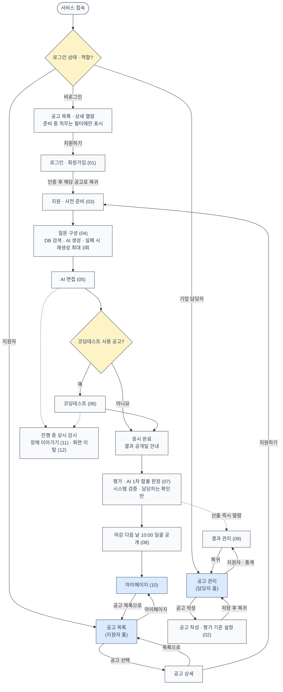

설계 기준: 지원자는 공고 목록, 기업 담당자는 공고 관리 화면이 홈이다. 기업 담당자 계정은 사전 발급되며 회원가입이 없다. 응시는 지원 건당 1회이고, 첫 질문이 제시되는 시점에 차감된다(INT-09). 1차 합불은 AI가 판정하고 시스템이 검증하며, 담당자를 포함해 누구도 수정할 수 없다(1-3 ①②).

---

## 01 회원가입·로그인

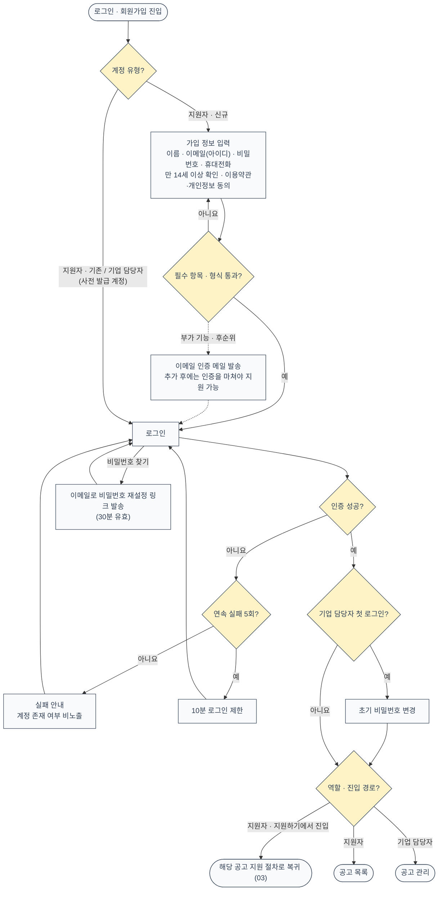

설계 기준: 이메일 인증은 부가 기능(후순위)이다. 추가 전에는 인증 없이 가입·지원할 수 있고, 점선은 추가 후 경로다(ACC-02). 생년월일·성별·주소·사진·주민등록번호는 수집하지 않는다(ACC-02). 세션은 마지막 요청 후 2시간 유지하며 면접 중에는 연장한다(ACC-01). 복귀 경로는 허용된 내부 경로만 쓴다(ACC-04). 기업 담당자는 소속 기업 데이터만, 지원자는 본인 데이터만 조회하며 서버가 모든 요청에서 범위를 검증한다(ACC-06).

---

## 02 공고 작성·평가 기준 설정

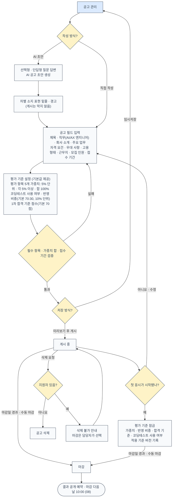

설계 기준: 질문은 기업 담당자가 입력·선택·편집하지 않는다(JOB-06). 평가 항목과 루브릭은 수정할 수 없고 가중치만 조정한다(JOB-04). 코딩테스트 문제는 담당자가 입력하지 않고 운영 측 문제 은행에서 시스템이 출제한다(JOB-03). ‘준비 중’ 직무 6개는 직무 선택 목록에 보이지만 선택할 수 없다(2-4). 잠금 이후에는 기존 결과를 재산출하지 않는다(JOB-07).

---

## 03 지원·사전 준비

```mermaid
flowchart TD
    classDef startEnd fill:#F8FAFC,stroke:#334155,color:#334155
    classDef decision fill:#FEF3C7,stroke:#334155,color:#334155
    classDef hub fill:#DBEAFE,stroke:#334155,color:#334155
    classDef process fill:#F8FAFC,stroke:#334155,color:#334155

    jobDetail["공고 상세<br/>코딩테스트 포함 여부 · 예상 소요 시간 · 결과 공개일"]:::hub -- 지원하기 --> loggedIn{"로그인 상태?"}:::decision
    loggedIn -- 아니요 --> login["로그인 · 가입 (01)"]:::process
    login -- "인증 후 복귀" --> applyCheck
    loggedIn -- 예 --> applyCheck{"서버 검증<br/>접수 기간 · 중복 지원 · 응시 이력<br/>(이메일 인증 추가 후: 인증 여부)"}:::decision
    applyCheck -- "실패 (마감 · 이미 지원 · 응시 종료/취소 이력)" --> denied["지원 불가 사유 안내"]:::process
    denied --> jobDetail

    applyCheck -- 통과 --> consent["필수 동의 (APP-03)<br/>① 응시 데이터 수집·이용 ② AI 자동 평가·결과 자동 산출, 설명 요구권 안내<br/>③ 지원 기업에 결과 제공 ④ 보관 기간(응시 데이터 7일 · 녹화 3일)<br/>⑤ 응시 규칙(1회 응시 · 중단 버튼 없음 · 화면 이탈 경고/강제 퇴장)"]:::process
    consent --> agreed{"모두 동의?"}:::decision
    agreed -- 아니요 --> noConsent["다음 단계 진행 불가"]:::process
    noConsent --> jobDetail
    agreed -- 예 --> consentLog["동의 문구 버전 · 항목 · 일시 기록"]:::process

    consentLog --> resumeWay{"이력서 제출 방식?"}:::decision
    resumeWay -- "PDF 업로드 (10MB 이하)" --> fileType{"파일 유형?"}:::decision
    fileType -- 텍스트 PDF --> textExtract["PDF 텍스트 바로 추출"]:::process
    fileType -- "스캔(이미지) PDF" --> ocr["온프레미스 OCR 텍스트 추출"]:::process
    fileType -- "PDF가 아닌 파일" --> notPdf["PDF만 업로드할 수 있다는 안내<br/>(이미지 · 기타 파일 불가)"]:::process
    notPdf --> resumeWay
    ocr --> ocrOk{"OCR 성공 · 인식 품질 기준 충족?"}:::decision
    ocrOk -- "아니요 · 실패 · 품질 미달" --> ocrGuide["추출 불가 안내 · 직접 작성 안내<br/>(흐름은 멈추지 않음)"]:::process
    ocrOk -- 예 --> extract
    textExtract --> extract["AI 정보 추출<br/>학력 · 경력 · 프로젝트 · 기술 · 자격"]:::process
    ocrGuide --> manual
    resumeWay -- 직접 작성 --> manual["이력서 직접 작성"]:::process
    resumeWay -- 마이페이지 등록본 --> loadSaved["등록본 불러오기"]:::process
    extract --> confirm["지원자 확인 · 수정 (필수)<br/>OCR로 추출한 항목은 원본과 대조하도록 표시"]:::process
    manual --> confirm
    loadSaved --> confirm
    confirm --> basicInfo{"기본 정보 충족?<br/>성명 + 학력 또는 경력 1건 이상"}:::decision
    basicInfo -- 아니요 --> confirm
    basicInfo -- 예 --> applied["지원 완료 · 응시 상태 '준비 중'<br/>이력서 스냅샷 저장(변경 불가)"]:::process

    applied --> envCheck["환경 점검 (APP-06)<br/>① 마이크 입력 레벨 ② 카메라 영상 ③ 스피커 테스트음 후 '들립니다' 확인<br/>④ 네트워크 상태 ⑤ AI 서버 상태"]:::process
    envCheck --> envOk{"모두 통과?"}:::decision
    envOk -- 아니요 --> envFix["실패 항목 안내 · 시작 버튼 비활성"]:::process
    envFix -- 재점검 --> envCheck
    envOk -- 예 --> rules["시작 전 안내 (APP-07)<br/>진행 방식 · 질문 수 · 답변 시간 · 코딩테스트 여부 · 예상 소요 시간<br/>중단 버튼 없음 · 장애 시 이어가기 · 화면 이탈 1회 경고 · 2회 취소"]:::process
    rules --> ruleCheck{"규칙 확인 체크?"}:::decision
    ruleCheck -- 아니요 --> rules
    ruleCheck -- "예 · '면접 시작' 선택" --> capacity{"진행 중 면접이 상한 N건 미만?<br/>N은 운영 설정값 (INT-08)"}:::decision
    capacity -- 아니요 --> waitLater["시작 불가 안내 · '대기' 상태<br/>응시 횟수 미차감 · 마이페이지에서 나중에 시작"]:::process
    waitLater --> toMyPage(["마이페이지 (10)"]):::startEnd
    capacity -- 예 --> begin(["전체 화면 전환 → 질문 구성 (04) → AI 면접 (05)"]):::startEnd
```

설계 기준: 중복 지원·응시 이력 검증을 동의·이력서 입력보다 먼저 해서, 통과할 수 없는 지원자가 입력을 반복하지 않게 한다. 자기소개서는 필수가 아니다(APP-05). 지원 환경은 데스크톱 Chrome·Edge 최신 2개 버전이다. 상한 N은 운영 장비에서 측정해 정한 초기값으로 시작하며, 서비스 재시작 없이 바꿀 수 있다(AC-21).

---

## 04 질문 구성

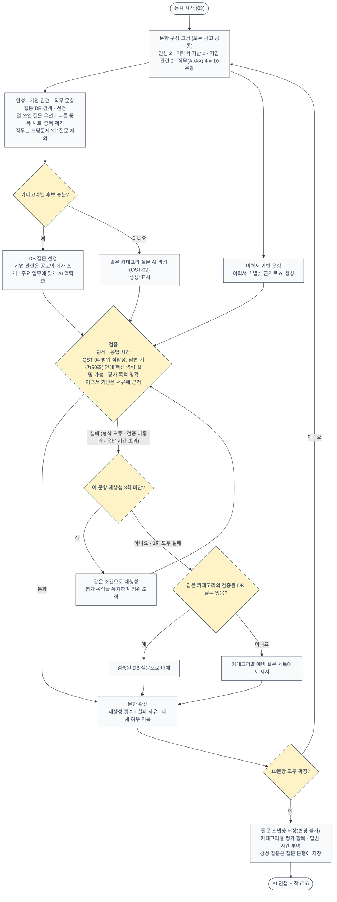

설계 기준: 질문은 담당자의 검토·승인 없이 시스템이 자동 구성한다(JOB-06, QST-01~03). AI가 질문을 만들지 못하면(이력서 기반·기업 관련 맥락화·QST-02 생성·QST-04 범위 조정) 그 문항을 같은 조건으로 최대 3회 재생성한다. 3회 모두 실패하면 검증된 DB 질문으로, DB 후보도 없으면 카테고리별 예비 질문 세트로 대체해 면접을 멈추지 않는다(QST-05, 7-4). 대체는 감점·장애 판정 대상이 아니다. 평가와 리포트는 질문 스냅샷을 기준으로 한다(QST-03).

---

## 05 AI 면접·꼬리질문

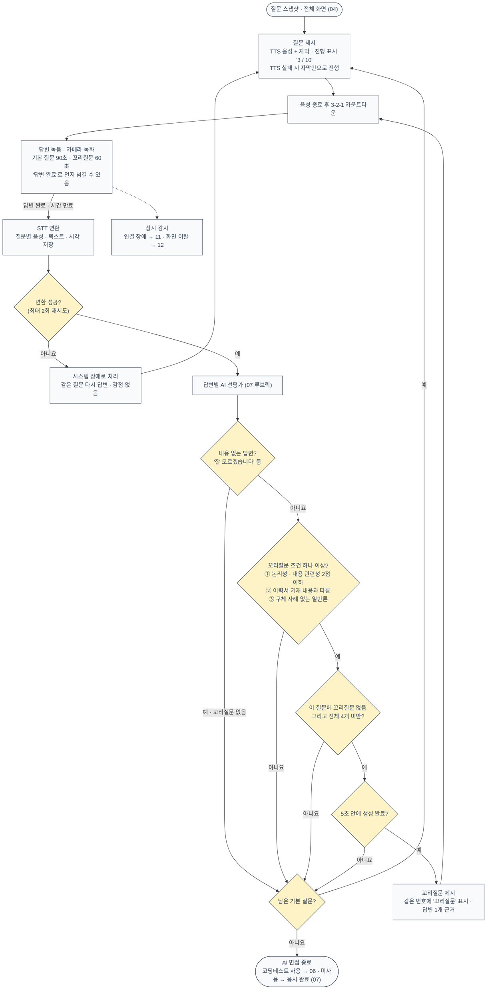

설계 기준: 중단·일시정지 버튼은 없다(INT-03). 면접관 아바타는 쓰지 않는다(INT-01). 녹화는 평가에 쓰지 않고 장애·부정행위 판정 확인용으로 3일만 보관한다(INT-05). 꼬리질문은 거짓 여부를 판정하지 않는다. 내용 없는 답변은 같은 질문을 반복하지 않고 해당 문항을 1점으로 평가한다(INT-07). 예상 소요 시간은 약 25분이다.

---

## 06 코딩테스트 응시·채점

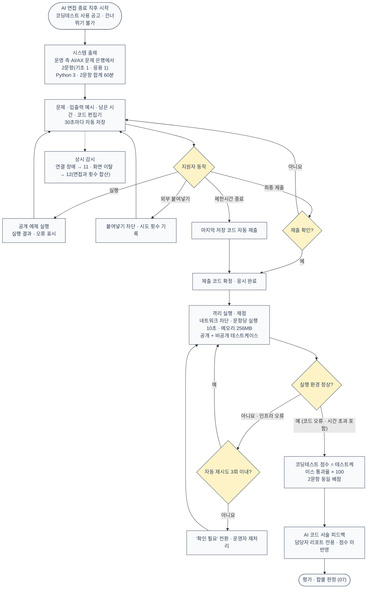

설계 기준: **AI 도우미 없이 일반 코딩테스트로 진행하며, AI 사용 이력은 수집하지 않는다.** 코드 관련 꼬리질문도 제공하지 않는다(COD-06). 점수는 작성 코드의 테스트케이스 통과율로만 계산한다. 실행만으로는 응시가 완료되지 않고 최종 제출(또는 시간 종료 자동 제출)이 필요하다(COD-01). 정답과 비공개 테스트는 지원자 화면과 AI 입력에 노출하지 않는다(COD-05). 실행 환경 오류는 지원자 오답으로 처리하지 않는다. 시스템 장애로 끊긴 시간은 남은 시간에서 빼지 않는다(COD-04).

---

## 07 평가·채점·AI 1차 합불 판정

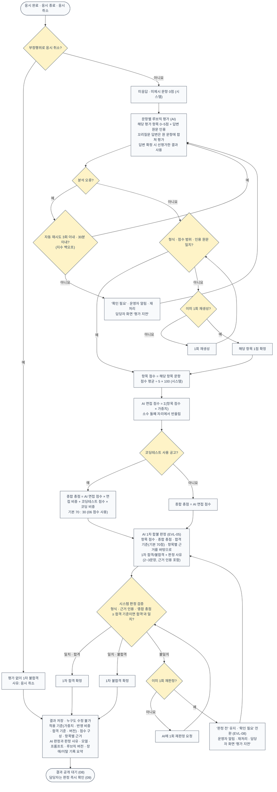

평가 항목과 기본 가중치: 직무 전문성 30% · 논리성 25% · 내용 관련성·구체성 20% · 전달력 10% · 조직 적합성 15%.

루브릭 척도: 0 미응답 · 1 답변했으나 최저 수준(관련성 거의 없음, ‘모르겠습니다’, 근거 인용 불가) · 2 부분적 · 3 기본 충족 · 4 우수 · 5 탁월.

설계 기준: AI는 루브릭 채점·근거 인용과 함께 1차 합격·불합격과 판정 사유를 낸다. 시스템은 점수를 집계하고, AI 판정이 형식·점수 범위·근거 인용·합격 기준과 어긋나지 않는지 검증하고 기록한다(1-3 ②, EVL-03~06). 기준과 어긋난 판정은 확정되지 않는다(AC-13). 부정행위로 취소된 응시는 평가 없이 1차 불합격이다. 이름·연락처 등 인적 정보와 음성 특성은 평가 입력에서 뺀다. 담당자의 승인 단계와 수정 기능은 없다. 응시 완료 후 p90 10분 안에 결과를 산출하며, ‘분석 실패’라는 최종 상태는 두지 않는다(EVL-08).

---

## 08 결과 공개·알림·보관 삭제

### 08-A 결과 공개와 보관

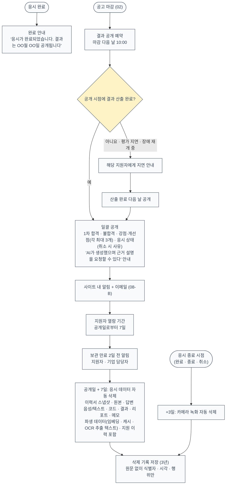

설계 기준: 공개 전에는 결과가 지원자 화면·API에 나타나지 않는다. 지원자 공개용 결과는 담당자용과 별도로 만들며, 점수·총점·코딩테스트 세부·근거 인용·내부 기록은 공개하지 않는다(RPT-03, RPT-04). 보관 만료 삭제 작업은 매일 실행하고 결과를 기록한다(10-3).

### 08-B 알림 발송

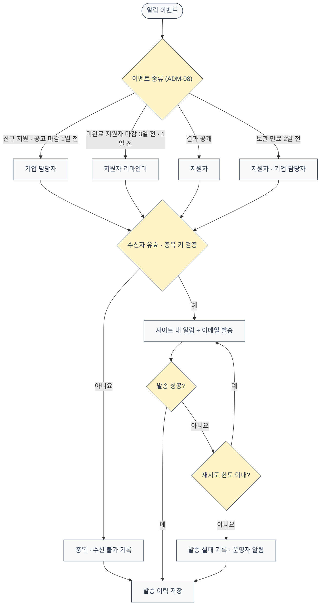

설계 기준: 면접 일정 관리·통보 기능과 외부 캘린더 연동은 범위 밖이다(N1, N5, C-23). 같은 이벤트는 한 번만 발송한다.

---

## 09 기업 담당자 결과 관리

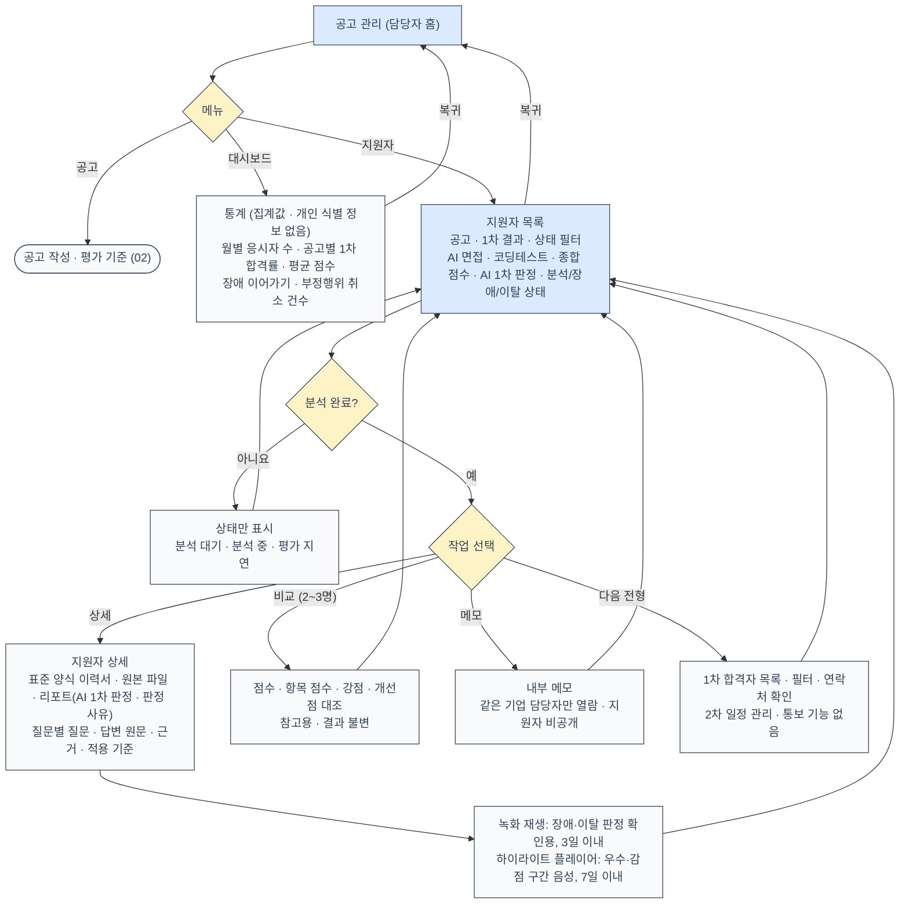

설계 기준: 담당자는 AI 판정 결과와 판정 사유·적용 기준·근거를 확인만 하며, 판정을 바꾸는 버튼·입력은 없다(ADM-01, AC-14). 담당자는 판정 즉시 결과를 볼 수 있지만, 지원자에게는 마감 다음 날 10:00에 공개된다. 응시 데이터는 결과 공개일로부터 7일 뒤 삭제되므로 다음 전형 대상자 관리는 그 안에 끝내야 하며, 삭제 2일 전 알림을 보낸다(ADM-06). 담당자용 리포트 구성은 RPT-01을 따른다.

---

## 10 지원자 마이페이지

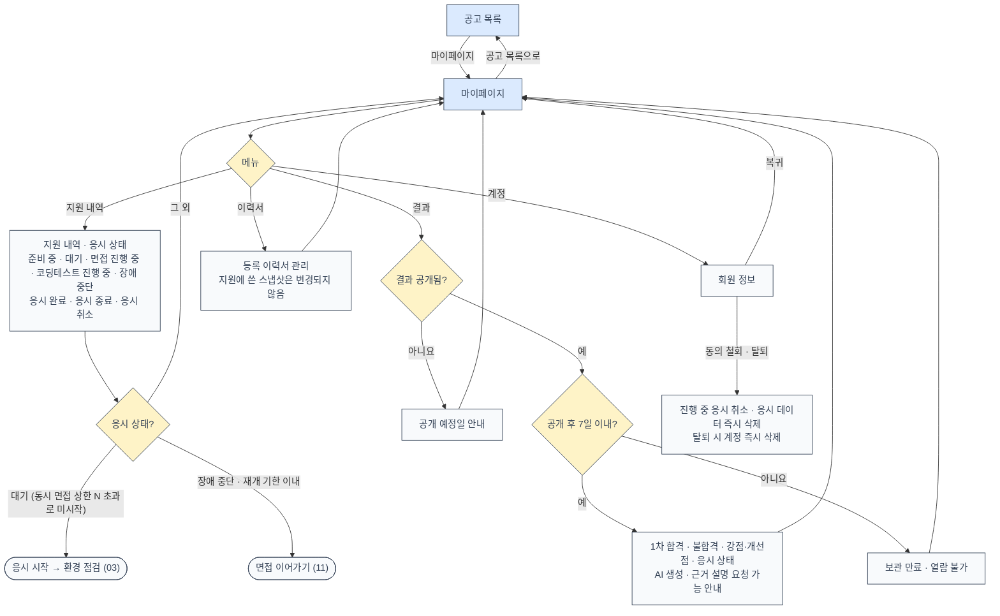

설계 기준: 응시는 원칙적으로 공고 상세의 지원 절차(03)에서 시작한다. 마이페이지에서 응시로 들어가는 경로는 동시 응시 상한으로 시작하지 못한 경우(INT-08)와 장애 이어가기(RES-03) 두 가지뿐이다. 지원에 쓴 이력서와 서류는 수정할 수 없다(APP-05).

---

## 11 장애 이어가기

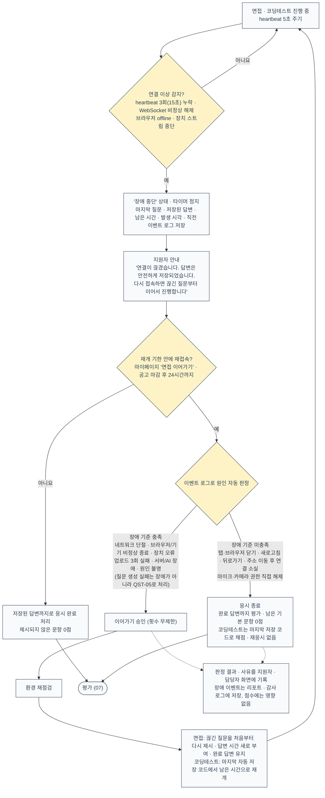

설계 기준: 장애로 끊긴 시간은 면접 답변 시간과 코딩테스트 제한시간에서 빼지 않는다(RES-01). 판정은 시스템이 기록을 근거로 자동 수행하며 수동 검토 단계는 없다. 원인을 특정할 수 없으면 지원자에게 유리하게 장애로 판정한다. 장애로 판정된 연결 소실은 화면 이탈 횟수에 넣지 않는다(CHT-04).

---

## 12 부정행위: 화면 이탈

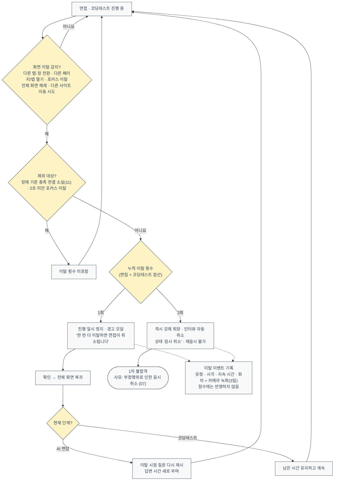

설계 기준: 이탈은 경고와 취소로만 처리하고 점수에 반영하지 않는다(CHT-05). 시선 추적·얼굴 표정 분석으로 부정행위를 판정하지 않는다(CHT-06). 담당자는 이탈 기록과 녹화로 판정 근거를 확인할 수 있다.

---

## PRD에 정의되지 않아 가정한 부분

도면을 그리며 PRD v1.1만으로는 정해지지 않은 부분은 아래처럼 가정했다. PRD 다음 개정 때 확정이 필요하다. 06v에 있던 ‘생성 사이클 세는 단위’와 ‘이력서 기반 문항 대체 대상’은 v1.1 QST-05(문항별 3회, DB 후보가 없으면 예비 질문 세트)로 해소되어 뺐다.

| 위치 | 가정 내용 | 근거 |
|---|---|---|
| 03 지원 | OCR(스캔 PDF 전용, 이미지 파일 불가)은 팀 결정으로 도면에 먼저 넣었고 PRD 개정 예정이다. 페이지 수 상한과 OCR 처리 시간 목표는 아직 정해지지 않았다 | APP-04, N4, C-22 |
| 04 질문 구성 | 질문 구성 시점은 응시 시작 직후(지원자별)로 둔다. 이력서 기반 문항이 지원자마다 다르기 때문이다 | QST-01~03 |
| 04 질문 구성 | ‘카테고리별 예비 질문 세트’를 누가 만들고 관리하는지 정의가 없다. 운영 측 준비물로 가정했다 | QST-05 |
| 07·08 | 지원자의 ‘근거 설명 요청’을 받는 창구와 처리 기한이 없다. 05v의 마이페이지 ‘문의’는 PRD에 없어 뺐다 | RPT-03 |
| 06·07 | 운영자 역할(문제 은행 관리, ‘확인 필요’ 재처리, 담당자 계정 발급)은 3장 주체와 역할 표에 없고 표 아래 주석으로만 있다. 도면에는 ‘운영자’로만 표기했다 | EVL-08, 3장 |
| 08-A | 공개 시각(마감 다음 날 10:00)에 장애 재개 중인 지원자도 ‘지연 공개’로 처리한다. PRD는 재개 기한을 마감 후 24시간으로 두어 공개 시각보다 늦게 끝날 수 있다 | RES-03, EVL-08 |
| 06 | 코드 실행 환경 오류의 재시도 규칙은 PRD에 없어 분석 오류 규칙(3회 → 확인 필요 → 운영자 재처리)을 그대로 적용했다 | EVL-08 |
| 08-B | 알림별 수신자와 채널(사이트 내 알림 + 이메일)은 결과 공개 외에는 PRD에 명시가 없어 배정했다. 메일 발송 재시도 한도 수치도 없다 | ADM-08, RPT-02 |
